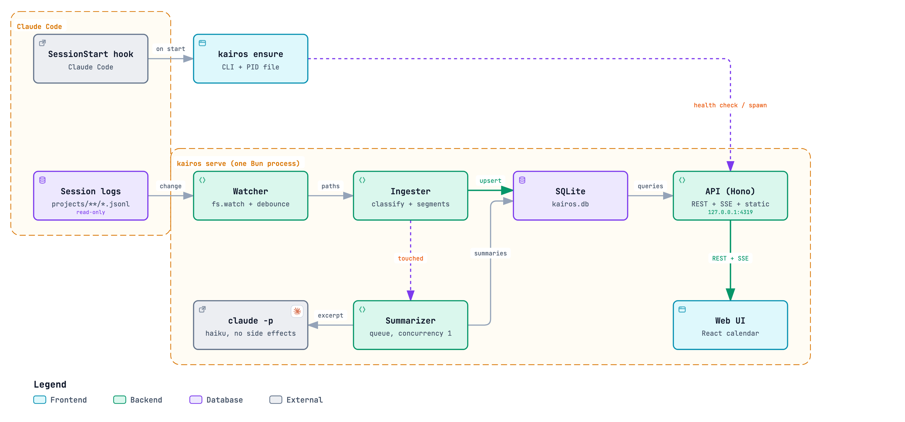
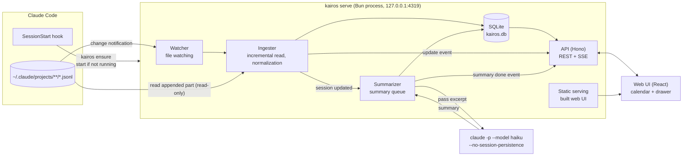
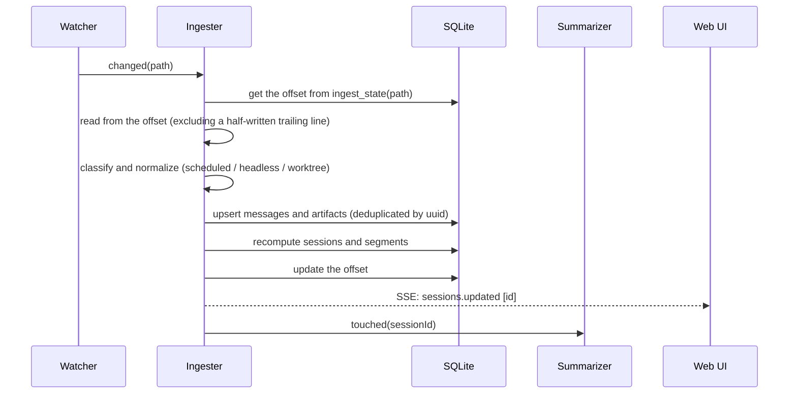
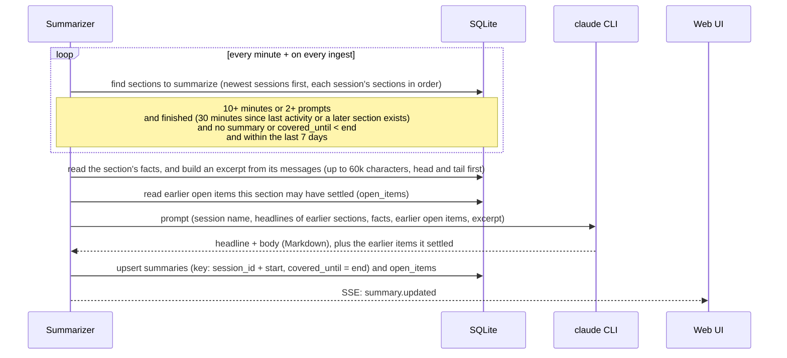
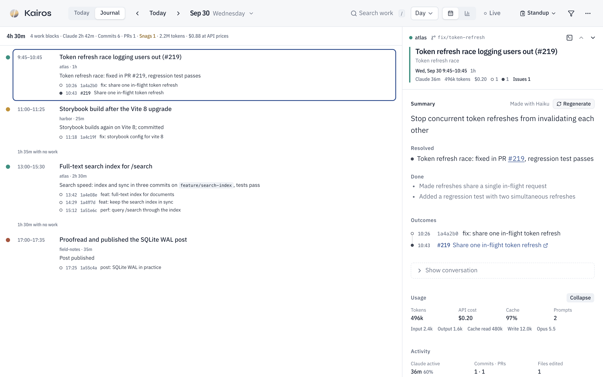
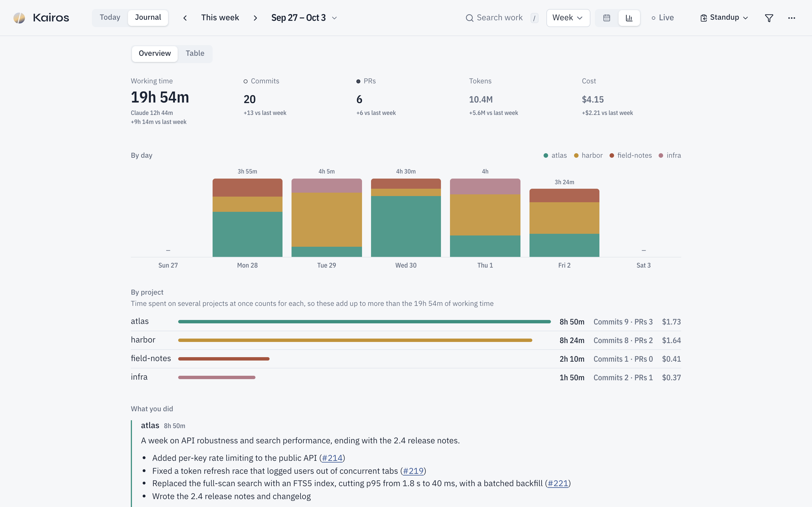
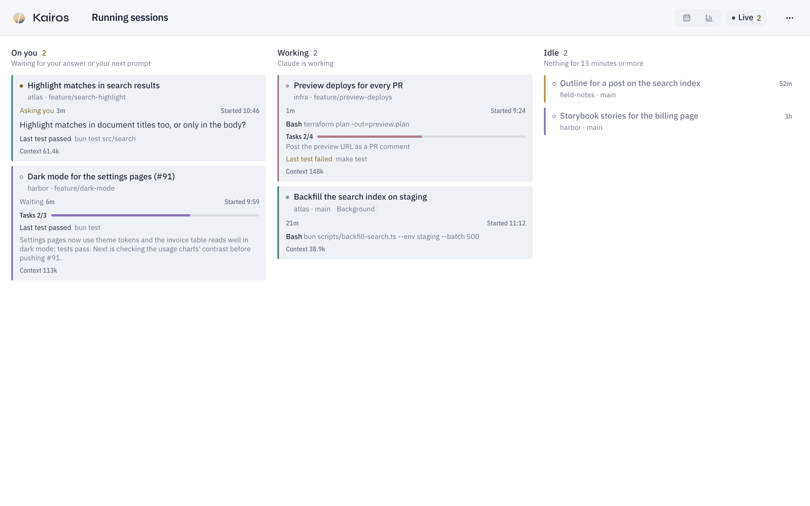

# Kairos Architecture

Last updated: 2026-10-05 / Related: [README](README.md) / [Design](DESIGN.md)

## 1. Overview



The image is rendered with [Archify](https://github.com/tt-a1i/archify) from [`docs/images/architecture.archify.json`](docs/images/architecture.archify.json); the Mermaid chart below has the full set of flows.



There is only one process, `kairos serve`, which handles ingest, summaries, the API and static serving together.

## 2. Components

| Component | Responsibility | Main implementation |
|---|---|---|
| Launcher | `kairos ensure`: checks `/api/health` and, if there's no response, starts `kairos serve` detached. A PID file prevents double starts | `src/cli` |
| Watcher | Watches `~/.claude/projects` recursively and hands changed jsonl files to the Ingester. Bursts of changes are coalesced (debounce) | `fs.watch` (recursive) |
| Ingester | Reads only the appended part from the offset in `ingest_state`. A half-written trailing line is left for next time. Classifies, normalizes and stores records | `src/server/ingest` |
| Segmenter | Builds work blocks from the activity times of human-initiated turns (split at 15 minutes), dropping blocks with neither a request nor a tool call. Recomputed on every session update | `src/server/ingest/segments.ts` |
| Summarizer | Queues sessions that need summaries and runs `claude -p` one at a time | `src/server/summarize` |
| API | REST for the calendar, details, conversations, summaries and project settings, plus SSE for update notifications | Hono |
| Web UI | Week and day calendar, detail drawer, filters (keyword, outcomes, states, length, branch, projects). English by default, Japanese selectable (`src/web/src/i18n`) | React + Tailwind + shadcn/ui |

Everything is TypeScript on Bun: Hono for the API, SQLite through `bun:sqlite`, React + Vite with Tailwind CSS and shadcn/ui for the UI, file watching + Server-Sent Events for live updates, and the `claude` CLI as a subprocess for summaries. The calendar is drawn with CSS Grid rather than a library, so its look can be tuned freely. API types in `src/shared` are shared by the server and the UI.

The schema lives in `MIGRATIONS` in `src/server/db/index.ts`. A continued session starts with a copy of the previous session's conversation under the same uuids, so message uniqueness is per session, and copies are flagged with `is_copy` and left out of aggregates.

## 3. Ingest flow



### 3.1 Normalization rules

| Rule | Criterion |
|---|---|
| Human prompt | `type=user` and `origin.kind=human` (any `promptSource`; `sdk` is also human input, e.g. from the desktop app). Includes slash commands |
| Automatic-run turn | From a user record with `turnOrigin=scheduled` until the next human prompt. Set `messages.is_scheduled=1` and exclude from work-block computation. `task-notification` and `peer` don't change how a turn is treated |
| SDK input | A main-thread `type=user` record with no `origin`, not `isMeta`, launched through the SDK (`entrypoint=sdk-cli` or `promptSource=sdk`): the request given to `claude -p` or the Agent SDK. Stored as `sdk_prompt` (a slash command as `/name args`). Not a human prompt, but it starts a work block and serves as the title and block title when there is no human prompt |
| Headless session | Zero human prompts and at least one SDK input. Hidden unless "Show automatic runs" is on (a server setting); sessions launched in Kairos's own summarizer directory are never shown. Summarized like any other session |
| Prompt-less work block | A block with no human prompt, `/loop` tick or tool call (a compaction, an API error or a short reply to a notification after a break) isn't drawn. Prompt-less blocks with tool calls stay: Claude acting on a notification on its own |
| Worktree | If the launch cwd is `<repo>/.claude/worktrees/<name>`, the project is `<repo>` and `<name>` becomes a secondary label. A later `relocated` / `worktree-state` only affects the secondary label |
| Same repository | If `.git/config` has an `origin` remote, the project is named after the repository and other clones of the same remote merge into it (a directory name that differs becomes the secondary label). Only the file is read; no git commands run |
| Temporary and gone directories | Without a remote, a directory that is gone from this machine (a container's checkout) or temporary takes the repository of the PRs opened from it, if they all point to one. A Claude Code scratchpad joins the project of the session that made it (its path encodes that session's directory). Other temporary directories (`/tmp`, `/private/tmp`, `/var/folders`, `~/.claude/jobs/*/tmp`) share one `tmp` project. The directory name becomes the secondary label |
| Title | `custom-title` > `agent-name` > `ai-title` > the first human prompt > the first SDK input |
| Recap | Store `system/away_summary` and use the last one as a placeholder until the AI summary is ready. Every recap is also kept as an `away_summary` message (main session only) for summaries to read |
| Compaction summary | Keep the body of the summary user record (`isCompactSummary`, main session only) as a `compact_summary` message. Past 40k characters, the middle is dropped: its pending tasks and next step come last |
| Notes | `away_summary` and `compact_summary` messages are Claude Code's notes about the work, not the work: they don't count toward work blocks or session start and end, never belong to an automatic run's turn, and the conversation view leaves them out |
| Tool output | Truncated to 4,000 characters, keeping the first quarter and the end (runners and errors print their totals and the reason last) |
| Thinking and images | Not stored |
| Commit | A successful Bash call containing `git commit` |
| PR merge | A successful Bash call running `gh pr merge` (or a result whose `gitOperation.pr.action` is `merged`), stored as a `merge` artifact keyed by PR number. Counted in a work block's activity; not listed with PRs |
| PR | A `pr-link` record. The title comes from `--title` of `gh pr create` and is linked by the URL in the result's `gitOperation.pr` |
| Token usage | Store the assistant record's `message.usage` in `usage`, one row per `message.id` (with the maximum `output_tokens`). With `usage.iterations`, store the sum of its steps, which includes server-side compaction. Subagent usage goes into the parent session. Returned per work block as the sum within its time range |
| Activity | Counted from messages and artifacts within the work block's time range: outcomes (commits, PRs and merges, up to 5 minutes after the end), files edited (distinct targets of Edit / Write, etc.), tool calls, subagents, stumbles (tool errors, interrupts, API errors), conversation compactions |
| Claude's working time and effort | Store `durationMs` of `system/turn_duration` in `turns`, and the response's `effort` in `usage.effort`. Copies in continued sessions are excluded by uuid |
| Cost | An estimate converted with the API price list (`src/server/pricing.ts`). It won't match what you actually pay when using a subscription |

The evidence for each rule and the fixture for each rule are collected in [tests/fixtures/README.md](tests/fixtures/README.md).

The parser has a `PARSER_VERSION`. Files whose `ingest_state.parser_version` doesn't match are re-read if the original log still exists.

## 4. Summary flow

Summaries are per section (one calendar block). With real data, a single session splits into as many as 15 blocks, so per-session summaries would repeat the same headline.



- The prompt's input has two parts. **Facts** come first: what the log records for the section, collected by code (`src/server/summarize/facts.ts`). The **excerpt** follows: the conversation, clipped
  - Facts: commits, PRs and merges (up to 5 minutes after the end); issues closed or filed with `gh issue`; the last test or check run where a command starts (not one started in the background; a multi-line command is named from the line that runs it, with "…" for the lines before), whether it passed and its totals, and how many earlier runs failed (when a pipe, `|| true` or a following command, on the same line or the next, hides the exit status, only its output is given); each task's state at the section's end (TaskCreate / TaskUpdate replayed over the whole session, since tasks outlive sections; tasks the section touched plus earlier ones still open); AskUserQuestion questions with their answers; interrupts; recaps (`away_summary`) up to 10 minutes after the end; and the pending tasks, current work and next step of compact summaries inside the section. Capped at 8k characters
  - Excerpt: prompts, replies (800 characters each, the section's last reply 4k, since that is where Claude sums up what is left), tool calls (160 characters), and the last line of failed tests, git and gh calls
- **Open items ledger** (`src/server/summarize/ledger.ts`, table `open_items`): each full summary's Open items become rows, with the issue / PR numbers, Jira keys and task IDs they name (a task also by its subject). Earlier open items go into the prompt when they come from the same session or a session it continues, or from the project and name a ref the section names too (newest 15). The model lists the ones the section settled under a `Closed:` item, which is stripped before the body is saved. Closing goes by refs first: after every save, an open item of the project whose every issue / PR / task ref the log later shows settled (`gh issue close`, a merged PR, a TaskUpdate to completed in the same session chain) is closed as `ref`, whichever section was summarized first. The model's word closes the rest as `model`. Regenerating a section replaces the items it opened (a later section's model close carries over to an item worded the same) and reopens the ones its summary closed; `ref` closes stay. Summaries written before the ledger add nothing to it. The summary view lists each project's items under its recap (`GET /api/open-items`): open at the end of the period, with those open 4 weeks or more folded away, and those closed during it. Items can be closed by hand as done or dismissed, and reopened; a hand close is kept when the opening section is regenerated. The drawer shows the earlier items a section settled (`Section.closes`). Recaps read the ledger (still open at the period's end, settled during it; dismissed items in neither) instead of the sections' Open lines, and it is part of the recap's input hash
- Concurrency is 1. On failure the reason is recorded and it retries up to 3 times after 1, 2 and 4 minutes
- For short sections (under 10 minutes and at most one prompt), only a headline is generated automatically. The body is stored in `summaries` as an empty string and returned by the API as no summary (`body: null`)
- The body of short sections and sections older than 7 days can be pushed to the priority queue with the button in the drawer (`POST /api/sessions/:id/sections/:start/summary`)
- `kairos summarize` backfills the rest from the CLI: it opens the DB directly and summarizes, one at a time, every finished section the automatic loop would pick if it had no 7-day limit (`findTargets` is shared by both). It strips the `CLAUDE*` variables before running `claude`, like the daemon does, since it may run inside a Claude Code session. A running server isn't notified, so the browser needs a reload. It stops after 3 failures in a row (e.g. `claude` not logged in)
- Sections without a headline (older than 7 days, in progress, not yet generated) show `segments.fallback_title`, computed at ingest (the first prompt, or failing that the first line of Claude's last reply)
- The summary language follows the UI language: the UI sends it with `PATCH /api/settings` and the server keeps it in `kv` (`summary_lang`), so it survives restarts from the SessionStart hook. Starting with `--summary-lang <en|ja>` fixes it and the UI's choice is ignored. Without either, English. Changing it doesn't touch existing summaries or recaps; they can be regenerated
- Headless runs (`claude -p` / Agent SDK sessions with no human prompt) are hidden unless the "⋯" menu turns them on; the choice is kept in `kv` (`show_headless`) so every read query agrees (`src/server/visibility.ts`). They are summarized either way. Sessions launched in Kairos's own summarizer directory are never shown or summarized. Recaps cover human work only
- `claude` runs with `--effort low` (`--summary-effort` changes it), in a dedicated working directory with `--no-session-persistence`, `--tools ""`, `--strict-mcp-config` and `--setting-sources project` to eliminate side effects

### 4.1 Recaps

A recap explains what was done on one project during a shown period (the summary view's week or day) in a few sentences and bullets, for a weekly report or for looking back.

- Written only on request (the summary view's "Summarize this work" button, `POST /api/recaps`), never automatically: a week has as many recaps as projects
- The input is the period's section headlines and summary bodies (sections starting in the period, from sessions with prompts), plus the PR and commit titles made during them, up to 40k characters (bodies are dropped first). Raw conversation is not read again
- Stored in `recaps` (key: project + period start and end) with a hash of the input. When the input changes (more work, a new section summary), the API marks the recap `stale`, and it can be rewritten
- Shares the Summarizer's queue, so only one `claude` runs at a time: requested section summaries first, then recaps, then automatic section summaries. A failure is shown in the view until the next request (no automatic retry)
- Recaps cover the whole project in the period; the view's filters don't change them

### 4.2 Running sessions

Kairos shows which Claude Code sessions are running and what each is doing, without hooks (`src/server/live/`).

- **Registry:** Claude Code keeps `~/.claude/sessions/<pid>.json` per running process (session ID, cwd, `kind` interactive / bg, `status` busy / idle and when it changed, name, process start time). It is undocumented, so every field is validated and anything odd is skipped. Only `<pid>.json` files are read; the `.key` files beside them (credentials for messaging other sessions) and the messaging sockets are never touched
- **Liveness:** an entry counts while its PID exists (`kill -0`) and `ps -o lstart` agrees with its recorded start time, so a file left by a crashed process doesn't claim a reused PID. The answer is remembered per entry while the entry stays in the registry; a failed `ps` is asked again
- **Tracker:** `LiveTracker` watches the directory (plus a 5-second poll for processes that die without cleaning up) and publishes `live.updated` only when the set of running sessions or a status changes
- **State:** `asking` when the main conversation's newest call without a result is AskUserQuestion or ExitPlanMode (and no new turn — a prompt, slash command or interrupt — came after it), else `working` for busy and `waiting` for idle. The UI turns a wait of 15 minutes or more into idle. A permission prompt can't be told apart from a long-running tool, so it shows as working
- **Details from the DB:** the call in flight (the same tail scan), the latest work block, the context size of the latest main-thread response, task progress (TaskCreate / TaskUpdate replayed as for summaries) and the last test run of the current block (`facts.ts`). A session not ingested yet is listed with what the registry knows
- **Cost (`cost.ts`):** from the latest main-thread response, the model, fast mode, the context window and the prompt cache's expiry; and at API list prices, the current block's spend, the spend rate over the last 15 minutes, and what the next request costs with the cache warm (the context as a cache read) or after it lapsed (the context written again). Logs don't record the window (a 1M session's model ID has no `[1m]`), so it is 1M for models marked `largeWindow` in `pricing.ts` (those Claude Code runs that way by default) or once any response went past 200k, else 200k. The cache lapses at the latest response plus the TTL of the latest cache write (1 hour or 5 minutes). Auto-compaction isn't marked: in real logs it fired anywhere from 210k to 970k, so there is no fixed threshold to draw
- **Spend:** across visible sessions, running or not (the calendar's visibility, minus hidden projects): today since local midnight, the rate over the last 15 minutes, and the last three hours in 5-minute buckets by project, for the band above the columns
- **Visibility:** as the calendar: launches in hidden directories never, headless runs (a registry kind other than interactive / bg, or a session with only SDK input) only with "Show headless runs"; sessions of hidden projects never (the UI drops them too, so hiding a project takes effect at once)
- The UI refetches on `live.updated` and on `sessions.updated` (the log moved on)
- The UI shows them on a page of their own (`?layout=live`), in three columns by state, opened from the toolbar's "Live" button, which carries the count of sessions waiting on you

## 5. API

| Method | Path | Description |
|---|---|---|
| GET | `/api/health` | Liveness check (used by the Launcher) |
| GET | `/api/calendar?from&to` | Sessions in the period and their sections (start, end, headline, summary body, PRs, prompt count, token usage, activity) |
| GET | `/api/search?q` | Sections matching every space-separated term across all periods, newest first (up to 50). Looks at headlines, summary bodies, session titles and branches, PR and commit titles, and the main conversation's prompts and replies. A `file:<path>` term matches only the paths of files edited in the section with Edit / Write (subagents included), and plain terms never match them. A plain `LIKE` scan (tens of ms on real data, about 100 ms with `file:`); queries under 2 characters return nothing |
| GET | `/api/spans?from&to` | Only the start, end and project of work blocks overlapping the period. Used for the "days with records" dots in the date picker; assigning to days is done in the UI's local time |
| GET | `/api/sessions/:id` | Session details (per-section summaries, artifacts, subagents) |
| GET | `/api/sessions/:id/messages?cursor&limit` | Paginated conversation |
| GET | `/api/settings` | Summary language, whether `--summary-lang` fixes it, and whether headless runs are shown |
| PATCH | `/api/settings` | `{ summaryLang?, showHeadless? }` (at least one): the UI's language, used for new summaries and recaps; whether calendar, search, navigation and the project list include headless sessions |
| GET | `/api/recaps?from&to` | Recaps of every project with work starting in the period, written or not (body, stale, pending, error) |
| POST | `/api/recaps` | `{ projectId, from, to }`: push writing or rewriting a recap onto the queue (202; 404 without work in the period; 429 when 20 are already waiting) |
| GET | `/api/open-items?from&to` | Open items of human work open at some point in the period (left open before its end, not closed before its start), with how and where each was closed |
| PATCH | `/api/open-items/:id` | `{ state: "done" \| "dismissed" \| "open" }`: close an open item by hand, or reopen one closed by hand (409 for one the log or a summary closed, or already closed) |
| POST | `/api/sessions/:id/sections/:start/summary` | Push generating or regenerating a section's summary onto the priority queue (202) |
| GET | `/api/projects` | List of projects (color, hidden flag) |
| PATCH | `/api/projects/:id` | Change color or hidden |
| GET | `/api/live` | Claude Code sessions running now (state, the tool call in flight or the question asked, tasks, last test, context size, model, cache expiry and cost), whether the session registry could be read, and spend across visible sessions (today, the current rate, the last three hours by project). See §4.2 |
| GET | `/api/events` | SSE (`sessions.updated` / `summary.updated` / `recap.updated` / `ingest.progress` / `live.updated`) |

Write routes (POST / PATCH) require `Content-Type: application/json` and the same Origin. Every request's Host header must be `127.0.0.1` or `localhost`.

Request and response types live in `src/shared` and are shared by the server and the frontend.

## 6. Screen layout


Toolbar on top, the calendar (or the summary, or the page of running sessions) below it, and the detail drawer on the right. Day view, where tall blocks also show their summary body:



The summary layout: period totals against the previous period, time by day and by project, and per-project recaps:



The page of running sessions: what waits on you, what is working, and idle sessions as single rows:



The screenshots are taken from a fictional week (`scripts/screenshots/demo.ts`) with `bun run screenshots`. The sessions shown as running get logs in the few hours before the capture and stand-in processes registered just before the live shot, since the page lists a session only while its PID exists. Retake them when the UI changes visibly.

- Blocks that overlap in time are placed side by side, as in Google Calendar
- Blocks show the summary headline. If there isn't enough height, only the headline is shown, with the full text on hover. Blocks with commits or PRs carry a small mark
- In the week view, days running several sessions in parallel get more width. If lanes would still be too narrow (e.g. with the drawer open), the selected day and its neighbors keep their width
- In the day view, tall blocks also show the worktree name, PR numbers and the summary body
- The search field filters the shown period and, while focused, lists matching work from every period; picking one jumps there
- The drawer is synced with the URL (`?session=`) and stays open across reloads
- The layout toggle switches between calendar and summary (`?layout=`, `c` / `s`). The summary has an overview tab and a table tab (`?layout=list`, `l`; the per-block table that used to be the list layout, keeping its own scroll and sticky header). The summary is computed in the browser from the same `/api/calendar` response (`src/web/src/lib/summary.ts`), plus the previous period's response for the change under each number, so it needs no API of its own

## 7. Directory layout

```
kairos/
├── .claude/            # Claude Code setup: path-scoped rules, hooks, skills, agents
├── docs/images/        # architecture diagram (rendered PNG and its Archify source) and screenshots
├── ARCHITECTURE.md     # this file
├── DESIGN.md           # visual design for agents (DESIGN.md format)
├── scripts/            # check-jsdoc.ts; screenshots/ (fictional demo week and the capture)
├── src/
│   ├── cli/            # the kairos command (ensure / open / status / stop / restart / serve / ingest / summarize / help); daemon.ts, help.ts
│   ├── server/
│   │   ├── db/         # schema and migrations
│   │   ├── ingest/     # watcher → reader → classify / records → ingester → segments; project, commits, prs
│   │   ├── summarize/  # summarizer (queue), digest (excerpt), prompt, claude (runs claude -p)
│   │   ├── api/        # Hono routes, SSE, security middleware
│   │   ├── queries.ts  # read queries behind the API
│   │   ├── pricing.ts  # API price list for cost estimates
│   │   └── serve.ts    # wires ingest, summaries and the API together
│   ├── shared/         # API types and constants
│   └── web/            # React app (Vite); i18n/ holds the UI messages
├── tests/fixtures/     # fictional jsonl logs generated by generate.ts (never copied from real logs)
└── package.json
```

## 8. Storage locations

| Kind | Path |
|---|---|
| DB | `~/Library/Application Support/kairos/kairos.db` |
| Log | `~/Library/Logs/kairos/server.log` |
| PID | `~/Library/Application Support/kairos/kairos.pid` |
| Working directory for summaries | `~/Library/Application Support/kairos/summarizer/` |

## 9. Performance

Measured on 2026-10-05 on an Apple M4 with 16 GB, Bun 1.3.11, against real logs: 1.0 GB in 645 jsonl files (1,068 files including subagent logs), 222 sessions, 117,869 messages.

| What | Result | How |
|---|---|---|
| First ingest (empty DB) | 7.9 s, peak memory about 580 MB | `kairos ingest --db <empty path>` under `/usr/bin/time -l` |
| Ingest on later starts | 0.1–0.2 s when nothing changed; about 1 s when a few files grew | `ingested … in` lines in `server.log` |
| DB size | 174 MB (about 17% of the logs) | file size after the first ingest |
| Server start until it answers | 0.18 s | `kairos ensure` until `/api/health` responds |
| `GET /api/calendar` for a busy week (92 KB) | 205 ms right after start, 30–45 ms after that | `curl -w %{time_total}` |
| `GET /api/sessions/:id` / `…/messages` for the largest session | 45 ms / 14 ms | same |
| Page open until the week's data is in | about 0.2 s (HTML parsed at 0.10 s, `/api/calendar` done at 0.20 s, `load` at 0.63 s once fonts arrive) | Navigation and Resource Timing in Chrome |

Start to display is well within the goal of showing the screen within 1 second, because the screen renders from the DB and ingest runs in the background. The first ingest is the slow part, and it happens once. The bundle is served uncompressed (JS 671 KB, CSS 569 KB); that costs nothing noticeable over loopback, so it is left as is.

## 10. Security

The server holds and returns conversations from every project, so it is treated as sensitive even though it only runs locally. Two things are assumed hostile: **other sites open in the same browser**, and **text inside the logs** (pasted web pages, tool output, anything Claude read).

| Threat | Defense | Where |
|---|---|---|
| Access from another machine | Listen on `127.0.0.1` only | `src/server/serve.ts` |
| DNS rebinding (a page whose domain resolves to `127.0.0.1` reads the API) | Reject any request whose Host header isn't `127.0.0.1` or `localhost` | `guardHost` in `src/server/api/security.ts` |
| CSRF (another page posts to the API) | Writes must be `Content-Type: application/json` — which a form or simple `fetch` can't send cross-origin without a preflight — and any Origin must be local. No CORS headers are ever sent | `guardWrite` |
| XSS from log text | Markdown is rendered with `react-markdown` defaults: no raw HTML, no `dangerouslySetInnerHTML`, no images | `src/web/src/components/Markdown.tsx` |
| Leaking to the outside by displaying a log (tracking pixels, remote fonts, scripts) | A CSP that allows only the app's own origin, plus `data:` images | `CSP` in `security.ts` |
| Prompt injection into summaries | `claude -p` gets no tools (`--tools ""`), no MCP servers (`--strict-mcp-config`), only project settings, an empty working directory, and the excerpt on stdin rather than in arguments or a shell. The worst a hostile log can do is spoil its own summary | `src/server/summarize/claude.ts` |
| Summaries showing up as sessions, or touching the logs | `--no-session-persistence`; Kairos never writes under `~/.claude` | same; a project hook blocks edits to `*.jsonl` |

GET routes and SSE have no side effects, so only the guarded write routes can change anything.

**What leaves the machine:** only the excerpts passed to `claude -p` for section summaries and recaps, sent through your own Claude Code login. Nothing else is fetched or sent.

Changes to any of this go through the `security-reviewer` agent (see `.claude/rules/api.md`).
