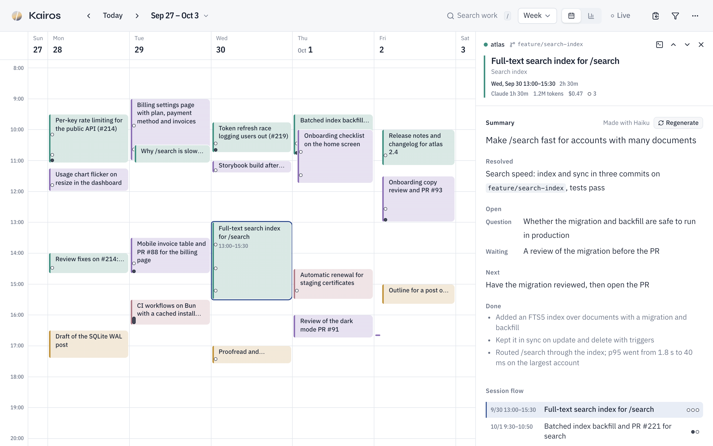
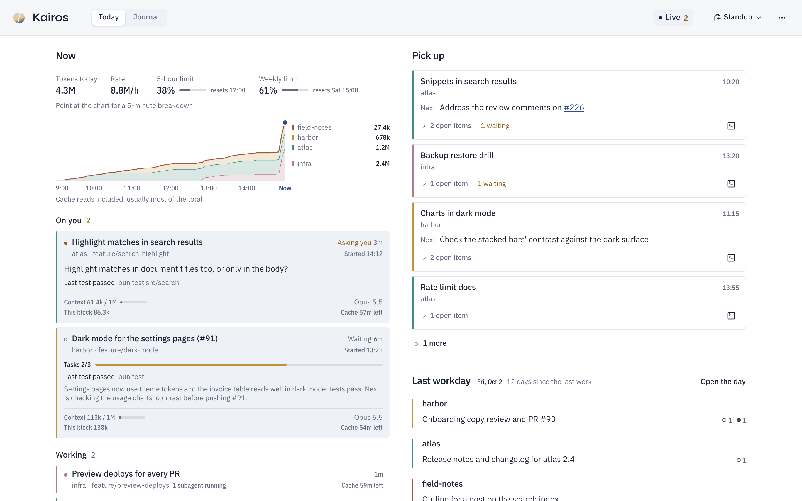

#  Kairos

A personal web app that keeps the memory of your Claude Code work: what is running now, what is left to pick up, and — on a calendar — what you were doing on a given day and at a given time.

> **Kairos** is Greek for "the meaningful moment". Where *chronos* is the time a clock ticks off, *kairos* is the time when something happened — the app gives the hours on a calendar their meaning: what you did then.

- Ingests the logs (`~/.claude/projects/**/*.jsonl`) read-only and stores them in SQLite. Even after Claude Code deletes its logs (30 days by default), Kairos keeps them
- Two places, switched at the top left: **Today** and the **Journal**
- Opens on Today (`/today`): today's tokens and every session running now, those waiting on you first, what recent sessions left to pick up (a card each, with the command that resumes it), beside what the last workday was about
- The Journal (`/journal/2026-10-01`) shows a month, a week or a day: the month lists each day's work, the week places it at its time, and the day lists it with the sessions that ran side by side and the selected block's detail beside it
- Automatically summarizes each work block (section) with `claude -p` (haiku): what was asked, what got settled and what was left open, and keeps the open items until the log or you close them
- Searches every period by summaries, prompts and replies, PR and commit titles, and branches; `file:<path>` finds the work that edited a file
- The Journal's Insights tab: working time, PRs, commits, tokens and estimated cost against the previous period, and per-project recaps written on request
- Copies a Markdown report (recaps, then each day's work by project with PR links, then what is still open) from any page: the last workday, today, this week, or the period on screen with its filters. It is the same text `kairos report` prints. Also copies `claude --resume` for any session
- Starts in the background whenever you launch Claude Code
- The UI is in English by default; Japanese can be selected from the "⋯" menu (saved per browser)



Design docs: [Architecture](ARCHITECTURE.md) / [Design](DESIGN.md) ([screens](docs/design/screens.md), [decisions](docs/design/decisions.md))

## Goals

**See at a glance what is running and what is left open; the past is reachable from there.** Watching and resuming happen many times a day, looking back once a day or once a week, so the first answers come first. That shapes the rest:

- What needs you comes first: a session waiting on you, then what is left to pick up, then what was done. Numbers (tokens, cost, snags) stay in the background
- Looking back stays a calendar: when something happened is still the way into it
- Blocks are readable even in the week view, and each one is named by its summary
- History outlives Claude Code's log retention (about 30 days), because it lives in Kairos's own DB
- The screen appears right away: it renders from the DB, and ingest reads only what was appended
- Summaries are written in the background, so they are already there when you open a block

**Not in scope:** task management for open items (no snooze, due dates or priorities: an item is done, won't be done, or was never an open item, and old ones fade out on their own), detailed cost and token analysis (only period totals and estimates are shown), team sharing or public access, acting on sessions (Kairos copies the resume command but never runs it), and syncing across machines. It is built for one personal Mac.

Ideas for later: a monthly heat map, logs from other tools such as Codex, notes and tags on blocks.

## Setup

Requirements: macOS, [Bun](https://bun.sh) 1.3 or later, Claude Code (logged in; used for summaries)

```sh
git clone <this repo> ~/dev/kairos && cd ~/dev/kairos
bun install
bun run build      # build the web UI (dist/web)
bun link           # put the kairos command in ~/.bun/bin
kairos open        # start and open in the browser (the first ingest takes a few seconds)
```

### Start automatically with Claude Code

Add the following to `hooks.SessionStart` in `~/.claude/settings.json`.

```json
{
  "type": "command",
  "command": "'/Users/<you>/.bun/bin/kairos' ensure 2>/dev/null || true",
  "timeout": 5
}
```

`kairos ensure` does nothing if the server is already running (about 20ms); otherwise it starts the server in the background and returns immediately. It prints nothing, so it doesn't affect the Claude conversation. The server keeps running after Claude Code exits. It doesn't open a browser — run `kairos open` or open http://127.0.0.1:4319 when you want to look.

### Plan usage limits

Today's token band can show how much of your plan's 5-hour and weekly limits is used, and when each resets. Session logs don't carry the limits; Claude Code passes them only to the status line command (Pro and Max plans, once a session has had a response). So `kairos statusline` wraps your status line: it records the limits, then runs your own status line command on the same input and prints what it prints. Put it in front of your current `statusLine.command` in `~/.claude/settings.json`, after `--`:

```json
"statusLine": {
  "type": "command",
  "command": "'/Users/<you>/.bun/bin/kairos' statusline -- npx -y ccstatusline@latest"
}
```

The command after `--` runs in a shell, as Claude Code runs it; quote one that uses pipes or variables as a single argument (`kairos statusline -- 'input=$(cat); echo "$input" | jq -r .model.display_name'`), so the outer shell leaves it alone. Without a status line of your own, leave out `--` and what follows; the line stays empty. The limits only move while Claude Code runs, so when the reading is more than 10 minutes old, the band says when it was taken (usage on claude.ai counts toward the same limits).

### Running sessions

Today's Now lists the Claude Code sessions running now, under today's tokens: On you (asking a question or plan approval, or done with its turn) as full cards, Working (with the tool call in flight, and the subagents at work with theirs) as a line each, and Idle (nothing for 15 minutes or more) folded behind its count. Each card adds the task list's progress, the last test run, Claude Code's recap and the context size. Clicking one opens its latest work block. The toolbar's "Live" button, which opens Today, shows how many sessions are waiting on you from any page, and so does the browser tab's title, e.g. `(2) Kairos`.



No hooks are needed: Kairos reads Claude Code's own record of running sessions (`~/.claude/sessions/<pid>.json`, read-only) alongside the logs. That record is undocumented, so a Claude Code update may change it; if it can't be read, Today says so (and `kairos doctor` warns). Whether a session is waiting on a permission prompt can't be told from these files, so such a session shows as working.

## Usage

| Command | What it does |
|---|---|
| `kairos open [day]` | Start the server and open it in the browser; with a day (`yesterday`, `2026-10-01`), open that day |
| `kairos status` | Whether it's running, the PID, its options, and where the log is |
| `kairos stop` / `kairos restart` | Stop / stop and start again (after updating Kairos). `restart` keeps the options the running server was started with (except `--port`) unless you give new ones |
| `kairos rebuild` | Build the web UI and restart, so local changes to Kairos take effect |
| `kairos report [day]` | A day's work (default: today) as Markdown: the period's recaps, the work per project, and what is still open (the text the UI's Standup menu copies). `--since` / `--until` for a period, `--full` adds the summaries, `--json` for scripts |
| `kairos open-items` | What summaries left open and nothing has closed yet, per project. `--project .` for the one you're in |
| `kairos search <terms>` | Find work blocks by summary, title, branch, PR, commit or conversation (`file:<path>` for edited files), with links into Kairos |
| `kairos doctor` | Check the setup: session logs, `claude`, the web build, the server and its port, the DB, the SessionStart hook, and the record of running sessions |
| `kairos logs [-f]` | The end of the server log (`-n <lines>`, `-f` to follow) |
| `kairos statusline -- <command>` | Claude Code's status line command: records the plan's usage limits for Today, then runs your own status line command (see [Plan usage limits](#plan-usage-limits)) |
| `kairos ingest` | Ingest logs manually (to build the DB without running the server) |
| `kairos summarize` | Summarize every work block that has no summary yet. The server only does the last 7 days on its own. `--since` / `--until <YYYY-MM-DD>` and `--limit <n>` narrow it; `--dry-run` only counts. `--old-format` regenerates the summaries written before open items were tracked, oldest first, so they show up in Pick up and the summary view (about $0.02 and 20 s each with haiku) |
| `kairos help [command]` | List the commands, or one command's options (also `kairos <command> --help`) |

Server options (`open`, `restart`, `rebuild`, `ensure`, `serve`): `--summary-model <model>` (default: haiku), `--summary-effort <low|medium|high|xhigh|max>` (how hard the model thinks; default: low), `--summary-lang <en|ja>` (language of the summaries; by default they follow the language chosen in the UI, English until one is chosen), `--no-auto-summary` (don't summarize automatically; only when requested with the button in the UI), `--port <n>` (default: 4319), `--claude-dir <path>` (Claude Code config directory; default: `~/.claude`), `--db <path>` (DB file; default: under the data directory)

Changing the language (in the UI or with `--summary-lang`) doesn't rewrite existing summaries. They stay as they are, and you can regenerate any of them from the drawer.

Keyboard shortcuts: `⌘K` the command palette (search work, jump to a day such as `9/30` or `last tue`, and run any toolbar action, each row showing its key), `h` the Today page (or click the mark), `←` `→` previous/next period, `t` move the period to today, `m` month view, `w` week view, `d` day page, `c` calendar, `s` summary (totals, time by day and project, what was done, and recaps), `n` the sessions running now, `l` the summary as a table (one row per block with sortable numbers), `j` `k` next/previous work block, `/` search (the shown period, plus every period in the list under the field; `↓` to pick), `Esc` close details, `?` menu with theme, language and shortcuts

### Updating

```sh
git pull && bun install && kairos rebuild
```

## Where data lives

| Kind | Location |
|---|---|
| DB | `~/Library/Application Support/kairos/kairos.db` |
| PID | `~/Library/Application Support/kairos/kairos.pid` |
| Log | `~/Library/Logs/kairos/server.log` |
| Working directory for summaries | `~/Library/Application Support/kairos/summarizer/` (stays empty) |

Set `KAIROS_DATA_DIR` to put the DB, PID and log somewhere else together (e.g. to try things out against a separate DB).

### About Claude Code's log retention

Kairos keeps what it ingested in its DB, so the calendar, summaries and conversations don't disappear even if you don't extend Claude Code's `cleanupPeriodDays`. However, sessions whose original logs are gone can't be re-read when Kairos updates its interpretation rules (`PARSER_VERSION`). If that matters to you, extend `cleanupPeriodDays` as well.

### Uninstalling

```sh
kairos stop
bun unlink                       # remove the kairos command (run in the repository)
rm -rf ~/Library/Application\ Support/kairos ~/Library/Logs/kairos
```

Then remove the `kairos ensure` entry from SessionStart in `~/.claude/settings.json`, and `kairos statusline --` from the front of `statusLine.command` if you added it.

## Troubleshooting

Start with `kairos doctor`, which checks most of the table below, then `kairos logs` (the log is at `~/Library/Logs/kairos/server.log`).

| Symptom | What to do |
|---|---|
| Nothing at http://127.0.0.1:4319 | Run `kairos open`. If it still doesn't answer, check the log: `cannot listen on 127.0.0.1:4319` means another process holds the port (often `bun run dev`) |
| The page is empty or 404, but the API answers | The web UI isn't built (the log says so). Run `kairos rebuild` |
| It doesn't start when Claude Code launches | Check that the SessionStart hook uses the absolute path to `kairos` (`which kairos`); hooks don't see your shell's `PATH` |
| Summaries say "Couldn't summarize" | The drawer tells you why. Usually `claude` isn't logged in (run `claude` in a terminal and log in) or isn't installed (install it, then `kairos restart`). Press the button in the drawer to try again |
| Recent work is missing or looks stale | Ingest runs on file changes; `kairos restart` re-reads anything changed since the last run |
| The DB looks broken, or you want to start over | `kairos stop`, delete `~/Library/Application Support/kairos/kairos.db*`, then `kairos open`. Everything is ingested again, but **sessions whose original logs Claude Code already deleted are gone for good**, and only the last 7 days are re-summarized automatically (run `kairos summarize` for the rest) |
| `bun run dev` fails to start the API | The background server holds the same port. Run `kairos stop` first |

## Development

```sh
bun run dev      # start the API (:4319) and Vite (:5173) together. The UI is at http://127.0.0.1:5173
bun run check    # Biome (lint and format) + type check + tests
bun run format   # auto-fix with Biome
```

`bun run dev` uses the same port as the background server, so run `kairos stop` first.

`bun run screenshots` retakes the screenshots in `docs/images/` from a fictional week, plus a few sessions shown as running (stand-in `sleep` processes registered like Claude Code's; needs `bun run build` and Google Chrome).

`bun run visual` shoots every view of the same week and a crowded stress day in light / dark, English / Japanese and two widths, and compares them with the baseline in `.visual/baseline` (needs Google Chrome; it builds the UI itself). When a change is intended, look at `.visual/diff`, then run `bun run visual --update`.

`bun run e2e` drives the built UI in the same headless Chrome on the same week: the keyboard alone, search fading, a reload keeping the URL's state, the Live count on every page, and new work after the server restarts. It also counts axe-core's accessibility violations per page, which may not grow past `tests/e2e/axe-baseline.json`.

The fictional test logs can be regenerated with `bun tests/fixtures/generate.ts` ([details](tests/fixtures/README.md)).

## License

[MIT](LICENSE)
